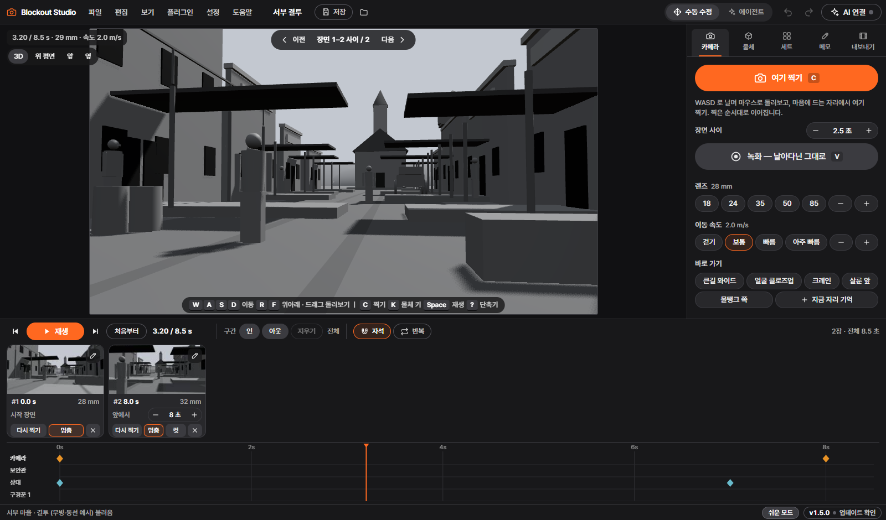

# 블록아웃 스튜디오 (Blockout Studio)

회색 3D 로 카메라 무빙과 동선을 잡아 보는 **'어린이 블렌더'**. 게임처럼 날아다니다 `C` 로 찍으면 찍은 순서대로 카메라 무빙이 되고, 사람·물체를 놓아 움직이게 한 뒤 MP4·도면·샷 리스트·블렌더(.glb)로 내보냅니다.
Claude · ChatGPT(Codex) 같은 AI 가 MCP 로 이 창을 직접 고칠 수 있고, **에이전트 모드**에서 고칠 곳을 눌러 메모를 남기면 AI 가 메모대로 고친 뒤 완료로 표시합니다. AI 없이도 모든 기능을 쓸 수 있습니다.



## 받기

1. [**Releases**](https://github.com/productionkhu-tech/blockout-studio/releases/latest) 에서 `BlockoutStudio.exe` 를 받습니다(약 10 MB, 설치 없음).
2. 원하는 폴더(바탕 화면·문서 등)에 두고 더블클릭합니다. zip 으로 받았다면 **꼭 압축을 풀고** 실행하세요(압축 안에서 켜면 업데이트가 남지 않습니다).
3. 처음 켤 때 「Windows의 PC 보호」 창이 뜨면 **추가 정보 → 실행**. 서명 인증서가 없는 새 앱이라 뜨는 창입니다.

필요한 것: Windows 10/11, Edge 또는 Chrome(앱 창으로 씀). 인터넷 없이도 됩니다(업데이트 확인만 인터넷).

## 쓰는 법

1. **날아다니기** — `W A S D` 이동, `R F` 위아래, `Q E` 고개, 마우스로 끌어 둘러보기, 휠 = 렌즈
2. **여기 찍기** — 마음에 드는 자리에서 `C`. 서너 번 찍으면 카메라가 그 순서대로 이어집니다
3. **재생 · 저장** — `Space` 재생, `Home` 처음으로, `Ctrl+S` 프로젝트 저장, 「내보내기」 탭에서 MP4

| | |
|---|---|
| 위 메뉴 | 파일(새로 · 열기 · 최근 · 저장 · 자동 저장 되살리기 · 내보내기) · 편집 · 보기 · 플러그인 · 설정 · 도움말 — 블렌더와 같은 자리 |
| 두 가지 모드 | **수동 수정**(직접 옮기고 찍기) · **에이전트**(물체 · 배경 · 피사체 · 장면 카드 · 시간 구간 · 동선을 눌러 고르고 수정 메모) — `F2` |
| 타임라인 | 처음으로 · 재생 · 끝으로, 구간 인/아웃(눈금 끌기도 됨 — 재생·MP4 가 그 구간만), **자석**(키에 붙기), 반복 |
| 단축키 | 앱에서 `?` = 전체 표, 설정 › 단축키에서 바꾸기(겹치는 키는 알려 줌) |

## 저장 — 어디에, 언제

- **지금 작업은 바뀔 때마다 자동으로 두 곳에** 남습니다: 앱 창의 저장소 + `%LOCALAPPDATA%\블록아웃 스튜디오\session.json`. 창을 그냥 닫거나 PC 가 꺼져도, 브라우저나 포트가 바뀌어도 다음에 켜면 그대로 이어서 열립니다.
- **프로젝트(Ctrl+S)** = `문서\블록아웃 스튜디오\프로젝트\<이름>.json` (+ 썸네일). 파일 › 열기에서 그림으로 고릅니다.
- **자동 저장** = 바뀐 게 있으면 2분마다, 최근 10개(파일 › 자동 저장에서 되살리기).
- 문서 폴더에 쓸 수 없는 PC(회사 보안의 「제어된 폴더 액세스」, 권한, 없는 드라이브)면 `%LOCALAPPDATA%\블록아웃 스튜디오\files\…` 에 저장합니다. 실제 위치는 설정 › 저장에서 보입니다.

## 업데이트 규칙

- **판 번호** = 주.부.고침 (예: `1.5.0`). 고침 = 버그만, 부 = 새 기능, 주 = 프로젝트 파일이 크게 바뀔 때(옛 파일은 계속 열림).
- **확인**: 켤 때(4초 뒤)와 6시간마다 GitHub 릴리스를 봅니다. 인터넷이 없으면 조용히 넘어갑니다.
- **받기**: 새 판이 있으면 뒤에서 받아 두고 크기 · SHA-256 을 확인합니다. **작업 중엔 절대 바꾸지 않습니다** — 다음에 켤 때 바꿔 끼웁니다. 오른쪽 아래 버전 버튼이 빛나고, 눌러서 「지금 다시 시작」 하면 바로 바뀝니다(저장 안 한 작업은 먼저 저장).
- **공지**: 바뀐 뒤 처음 켜면 「v… 로 업데이트되었습니다」와 바뀐 점을 한 번 보여 주고, 작업은 그대로 이어서 열립니다.
- **끄기**: 자동으로 받지 않으려면 설정 › 업데이트. exe 를 쓸 수 없는 폴더에 두었으면 받아 둘 수 없어 GitHub 링크를 알려 줍니다.
- **되돌리기**: exe 옆 `.old` 가 바로 전 판입니다(다음에 켤 때 정리됨). [Releases](https://github.com/productionkhu-tech/blockout-studio/releases) 에서 어느 판이든 받아 바꿔 쓸 수 있습니다.

## AI 로 만들기 (MCP)

1. 앱 위쪽 **「AI 연결」** → 쓰는 AI 앱(Claude 데스크톱 · ChatGPT 데스크톱의 Codex)의 **「연결」** 을 한 번 누릅니다.
2. 그 AI 앱을 **완전히 껐다 켭니다**(창만 닫지 말고 작업 표시줄 오른쪽 아이콘에서 「종료」).
3. AI 에게 「블록아웃 스튜디오에 의자 하나 놓아 줘」 → 이 창에 바로 생기면 성공. 이 앱이 꺼져 있어도 AI 가 부르면 켜집니다.

그다음엔 「빈 스튜디오에 성을 쌓고 카메라가 한 바퀴 돌게 해 줘」, 「내가 남긴 메모대로 고쳐 줘」처럼 말하면 됩니다. AI 가 한 일은 `Ctrl+Z` 로 하나씩 되돌립니다.

<details><summary>다른 AI 앱 — Claude Code · Codex CLI · Cursor · VS Code</summary>

앱의 「AI 연결 › 다른 AI 앱」에 이 PC 에 맞는 글이 복사 버튼과 함께 있습니다. 모양은 이렇습니다(`<exe>` = BlockoutStudio.exe 의 전체 경로).

| 앱 | 넣는 법 |
|---|---|
| Claude Code | `claude mcp add blockout-studio -- "<exe>" --mcp` |
| Codex CLI | `codex mcp add blockout-studio -- "<exe>" --mcp` |
| Cursor · Windsurf · Claude 데스크톱(직접) | 설정의 `mcpServers` 에 `"blockout-studio": {"command": "<exe>", "args": ["--mcp"]}` |
| VS Code | `.vscode/mcp.json` 의 `servers` 에 `"blockout-studio": {"type": "stdio", "command": "<exe>", "args": ["--mcp"]}` |
| 주소로 붙는 앱 | `http://127.0.0.1:8795/mcp` (Streamable HTTP, 앱이 켜져 있을 때) |

규격: MCP 2026-07-28(`server/discover`) 과 2025-11-25 이전(`initialize`) 둘 다. 도구 목록과 AI 설명서는 앱이 스스로 알려 주므로, 앱을 업데이트하면 AI 쪽도 저절로 따라옵니다.
</details>

**안 될 때**
- AI 앱의 도구(커넥터) 목록에 `blockout-studio` 가 없으면 → 2번을 다시(트레이에서 완전히 종료).
- 「AI 연결」 카드에 「다시 연결」이 보이면 → exe 를 다른 폴더로 옮긴 것. 눌러서 새 자리로 연결.
- ChatGPT 웹사이트(chatgpt.com)는 이 PC 의 앱에 못 붙습니다 → ChatGPT 데스크톱의 Codex 를 쓰세요.
- 회사 보안 프로그램이 막으면 → IT 담당자에게 「이 PC 안의 127.0.0.1 연결 허용」 요청.

AI 가 연결돼 있지 않으면 앱도 AI 를 권하지 않습니다(에이전트 모드를 처음 켤 때 한 번만 안내).

## 개발

```
python serve.py            # http://localhost:8795/ — 파일을 고치면 새로고침만 (?check = 자가 점검)
python build_exe.py        # _배포/ — exe · Claude 확장(.mcpb) · release/(GitHub 에 올릴 것)
```

- 앱: `index.html` + `app/` (ES 모듈, three.js 0.186 · mp4-muxer 를 `vendor/` 에 넣어 둠 — 빌드 도구 없음)
  - `studio.js` 본체 · `actions.js` 메뉴·단축키가 함께 쓰는 동작 목록 · `keymap.js` 단축키 · `menu.js` 위 메뉴 · `prefs.js` 환경 설정 · `projects.js` 파일 메뉴·세션 · `notes.js` 에이전트 모드·수정 메모 · `update.js` 업데이트 버튼 · `ui.js` 창·공용 도구
  - `api.js` AI 도구(여기에 하나 넣으면 AI 도구 목록·설명서에 저절로 들어감) · `bridge.js` 앱 서버와의 다리·AI 연결 창 · `mcp_guide.md` AI 설명서
  - 세트: `westtown.js` 서부 마을 · `hoistway.js` 엘리베이터 승강로·빈 스튜디오
- 서버: `launcher.py`(exe 본체) · `serve.py`(개발) · `server_api.py`(프로젝트·세션·자동 저장·업데이트 `/api/*`) · `mcp_bridge.py`(MCP)
- 시험할 때 실제 파일을 건드리지 않으려면 `BLOCKOUT_DATA_DIR` · `BLOCKOUT_DOCS_DIR` 환경 변수로 다른 폴더를 주면 됩니다.
- 디자인: 어두운 화면, 주황(#FF6820)은 아껴서, 보라(#8A38F5)는 AI·메모. 글꼴은 Pretendard, 없으면 함께 넣은 BlockoutSans(Pretendard 일부, OFL).

### 새 판 내기

1. `version.json` 의 `version` · `date` · `notes`(바뀐 점, 앱의 업데이트 공지에 그대로 나옴)를 고침
2. `python build_exe.py`
3. GitHub 에 태그 `v<판>` 릴리스를 **사전 릴리스로** 만들고 `_배포/release/` 의 `BlockoutStudio.exe`(이 이름 그대로) · `latest.json` · zip · .mcpb 를 올려 시험
4. 문제가 없으면 정식(Latest)으로 — 그때부터 쓰는 사람의 앱이 받습니다. `latest.json` 이 없으면 앱이 받은 파일을 검증할 수 없어 끼우지 않습니다.

## 라이선스

[MIT](LICENSE). 함께 넣은 것: [three.js](https://threejs.org) (MIT) · [mp4-muxer](https://github.com/Vanilagy/mp4-muxer) (MIT) · 글꼴 BlockoutSans = [Pretendard](https://github.com/orioncactus/pretendard) 일부 (SIL OFL 1.1, [app/fonts/OFL.txt](app/fonts/OFL.txt)).
